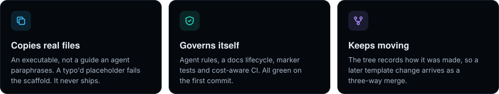
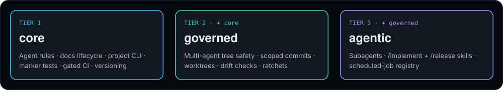

<p align="center">
  
</p>

<p align="center">
  <a href="https://github.com/skyrowlabs/skeletor/tags"></a>
  <a href="https://github.com/skyrowlabs/skeletor/actions/workflows/verify.yml"></a>
  <a href="docs/TIERS.md"></a>
  
  <a href="LICENSE"></a>
</p>

<p align="center">
  <a href="#quick-start"><b>Quick start</b></a> ·
  <a href="#pick-a-tier"><b>Pick a tier</b></a> ·
  <a href="#whats-in-the-box"><b>What's in the box</b></a> ·
  <a href="#staying-current"><b>Staying current</b></a> ·
  <a href="docs/DESIGN_RATIONALE.md"><b>Design rationale</b></a>
</p>

<p align="center">
  
</p>

## Quick start

Ask your agent *"Set up this project using skeletor."* once the skill is
installed with `bin/skeletor-install-skill`, or point any agent at
[`AGENTS.md`](AGENTS.md). Or run it yourself from the target repo:

```bash
"$SKELETOR"/bin/skeletor-new . --force \
  --name "My Project" --cli mp --tagline "What it is." --tier core
```

Then set up the generated tree. **Every new clone runs these**, because the
hooks and the merge driver live in `.git/config`:

```bash
python -m venv .venv
.venv/bin/pip install -r scripts/requirements.txt
.venv/bin/python scripts/install_project.py
.venv/bin/pre-commit install --install-hooks
.venv/bin/python scripts/git/install_merge_drivers.py
./mp check pre-push        # every host-runnable CI gate, green on a fresh tree
```

Adopting into a repo that already has code? [`docs/SETUP_GUIDE.md`](docs/SETUP_GUIDE.md).

## Pick a tier

<p align="center">
  
</p>

> [!TIP]
> **Pick the tier you will maintain, not the one that looks most thorough.**
> [`docs/TIERS.md`](docs/TIERS.md) has the cost of each.

| Flag | What it decides |
| ---- | --------------- |
| `--tier` | How much governance you will maintain |
| `--versioning` | **Does anything deploy this?** `release-please` if yes; `tag` if it runs from a checkout |
| `--agent` | `claude` ships `.claude/`; `none` omits it. The rules in `docs/rules/` ship either way |
| `--language` | Your *product's* language. The shell is python at every tier |
| `--shell-package` | Rename `cli/` if your product already owns it. Decide at scaffold time |

`--python` is a floor (default `3.12`), and `--python-ceiling` adds the other
end of the CI matrix.

## What's in the box

### skeletor's own tools

`bin/skeletor --help` lists these; each also runs directly by its path.

<!-- GENERATED bin/skeletor — do not hand-edit; run `bin/skeletor --markdown`. -->

| Tool | What it does |
| ---- | ------------ |
| `bin/skeletor-bump` | Bump every location of a pinned tool at once, or refuse to bump it at all. |
| `bin/skeletor-check-pins` | Report how far behind every version this repository pins its users to. |
| `bin/skeletor-components` | What did this tree take from skeletor, and has any of it moved since? |
| `bin/skeletor-install-skill` | Install the /new-project skill into the user's Claude Code config, so a blank repo can be scaffolded by asking rather than by remembering a path. |
| `bin/skeletor-maintain` | The weekly maintenance pass, run locally, waking an agent only if there is work. |
| `bin/skeletor-new` | Scaffold a new project from the skeletor template. |
| `bin/skeletor-upgrade` | Carry a template change into a tree that was scaffolded from an older one. |
| `bin/skeletor-verify` | Generate every tier and run the resulting tree's own gates against it. |

<!-- /GENERATED -->

### In the generated tree

One project CLI, `./<cli>`, whose command groups are **discovered by module**,
so an overlay adds one without patching an import list. The **Tier** column
says which tier ships each piece: `C` core, `G` governed, `A` agentic.

<details>
<summary><strong>The project CLI</strong></summary>

| Group | Subcommands | Tier |
| ----- | ----------- | :--: |
| `check` | `lint` · `docs` · `doc-links` · `doc-refs` · `reports` · `output` · `merge-drivers` · `pre-push` · `health` | C |
| `test` | `unit` · `integration` · `ui` · `manual` · `all` · `coverage` | C |
| `docs` | `index` · `status` · `file` · `queue-order` · `release-window` · `freeze-release` | C |
| `bug` · `task` | Capture an out-of-scope bug, or small self-contained work, as an issue; each refuses a capture missing a required section | C |
| `inbox` | Read back what the capture lanes hold, so a filed issue is not a queue nobody looks at | C |
| `doctor` | The account facts no file can state: default branch, release PRs, required checks, back-merge, CODEOWNERS | C |
| `commit` | Scoped commit that skips pre-commit's repo-wide stash | G |
| `worktree` | `new` · `drop` · `list` · `holders` | G |
| `report` | `<job>` · `cron` · `watch` | A |

</details>

<details>
<summary><strong>Conventions and agent tooling</strong></summary>

The conventions are plain markdown in `docs/rules/`, read because `AGENTS.md`
names them, and they ship whatever `--agent` says:

| Convention | Detail | Tier |
| ---------- | ------ | :--: |
| Rules | `commits` · `docs` · `output` · `testing` · `workflows` (+ `python`/`javascript` by overlay) | C |
| Shared-tree rule | `shared-tree.md` — what stops one agent deleting another's uncommitted work | G |

The tooling lives in `.claude/` and is omitted by `--agent none`:

| Tooling | Detail | Tier |
| ------- | ------ | :--: |
| Permission allowlist | `settings.json` — pre-approved git/gh/lint/CLI calls | C |
| Session bootstrap | `hooks/session-start.sh` installs the host toolchain in remote sessions | C |
| Subagents | `implementer` · `tester` · `documenter` | A |
| Skills | `/implement` (plan → code → tests → docs → filed) · `/release` (phased, stops for a human) | A |

</details>

<details>
<summary><strong>Documentation lifecycle</strong></summary>

| Capability | Detail | Tier |
| ---------- | ------ | :--: |
| Holding tank ↔ archive | `docs/TODO/` and `docs/implementations/`; a plan **moves**, never copies | C |
| Generated indexes | 2 JSON + 2 READMEs, rebuilt in dependency order by `scripts/docs/regen.py` | C |
| Plan classification | `shelf_status` · `blocked_on` gate · `queue_order` · `review_pr` — the last three never inferred | C |
| One imported sort key | `queue_order.py` — the published queue order *is* the real one | C |
| Lazy-loading index | `.github/DOCS_INDEX.md` — a task loads 1–3 docs, not the tree | C |
| Release-anchored reports | `release_window.py` — every report scoped to `<tag>..HEAD` | C |
| Release freeze | `freeze_release.py` — archives editions, re-anchors, refuses a re-freeze | C |
| Merge driver | `regen-docs` — generated files are regenerated on merge, never hand-resolved | C |
| Plan template | `_TEMPLATE.md`, including the `## Dropped, and why` section | C |

</details>

<details>
<summary><strong>Validation gates</strong></summary>

Every one is runnable locally with the same invocation CI uses.

| Gate | Catches | Tier |
| ---- | ------- | :--: |
| `check_doc_tables.py` | A doc registered in neither index table (`AGENTS.md`, `.github/DOCS_INDEX.md`) — one no agent will load | C |
| `check_doc_links.py` | Dead relative links and `#fragments` (ratchet); `--fix` repoints the unambiguous ones | C |
| `check_source_doc_refs.py` | `docs/*` paths cited from source comments that no longer resolve | C |
| `check_commit_subjects.py` | A pushed subject Release Please would silently ignore — or, versioned by tag, one the commit-msg hook would have refused | C |
| `regen.py --check` | A generated index that is stale in the commit that changed its source | C |
| `release_window.py --check` | A report whose anchor is missing, malformed, or wrong for where it lives | C |
| `check_skip_budget.py` | A suite that quietly stopped testing (ratchet) | C |
| `check_coverage_budget.py` | Coverage sliding while nobody looks (ratchet) | C |
| `install_merge_drivers.py --check` | A clone missing the merge driver or `commit.template`, plus regenerations owed | C |
| `check_output_discipline.py` | A status symbol or a stream picked outside `scripts/output.py` — auto-enrolled | C |
| `check_workflow_drift.py` | CI jobs that drift apart: one booting the stack without the pinned python, one running pytest without the project install — auto-enrolled, not a registry | G |
| `tree_lock.py` | Whether a branch change would strand somebody's work | G |

</details>

<details>
<summary><strong>Testing</strong></summary>

| Capability | Detail | Tier |
| ---------- | ------ | :--: |
| Marker registration | A file joins a suite by declaring `pytestmark` — no registry anywhere | C |
| CLI smoke + flag contract | Every command answers `--help` and every read-only one runs; a flag the CLI forwards must be one the script defines | C |
| Docs lifecycle end-to-end | A plan **moves** to the archive and every index follows — run on a disposable copy of the tree | C |
| `require_or_skip` | Skips locally, **fails** in CI, so "green" means "ran" | C |
| Ratchets | Skip count and coverage, each moved deliberately in the same commit | C |
| Shipped tests | `tests/` arrives populated — the shell tests itself, and those tests are the worked example for yours | C |
| Suite hardening | `--strict-markers`, return-not-none as an error, per-test timeout sized for CI | C |
| Registry tests | `reporting_jobs` — registry ↔ CLI ↔ prompts ↔ heartbeats ↔ cron collisions | A |

</details>

<details>
<summary><strong>CI/CD and cost control</strong></summary>

| Capability | Detail | Tier |
| ---------- | ------ | :--: |
| Gate job | Computes `full_suite`/`docs_only` once; every expensive job is gated on it | C |
| Shared gating definition | `docs-only.cjs` — one decision order, read by both workflows, **fail-open** | C |
| Draft discipline | A draft carrying code runs the cheap jobs; `ready_for_review` can only ever add | C |
| Monotonic transitions | Marking a PR ready never *reduces* what runs — asserted, not assumed | C |
| Job-level skipping | Never `paths-ignore` — a required check that never reports blocks forever | C |
| Docs validation workflow | PR-only, by design; the nightly covers direct pushes | C |
| Draft-discipline bot | Comments on a PR opened ready, with the cheaper loop | C |
| Nightly coverage | The expensive suites, off the pre-merge path | G |
| Dependabot | Exempt from gating so bumps actually run the suite before auto-merge | G |
| CODEOWNERS + templates | Bug/feature forms shaped like an actionable capture | G |

</details>

<details>
<summary><strong>Code governance</strong></summary>

| Capability | Detail | Tier |
| ---------- | ------ | :--: |
| Blocking lint set | flake8 `E9,F63,F7,F82,F401` + isort + black; complexity flagged, not blocked | C |
| Whole-project types | pyright `standard` in both the hook and CI — one stale error blocks everyone | C |
| One version pin | `.pre-commit-config.yaml` is the source of truth; parity test enforces mirrors | C |
| Pre-commit hooks | Conventional commit-msg, `.env` block, large-file guard, docs gates | C |
| ESLint ratchet | `--max-warnings=<baseline>`, whole-tree, may only go down | C |
| Prettier | Owns formatting so no lint rule has to argue with it | C |

</details>

<details>
<summary><strong>Versioning and release</strong></summary>

| Capability | Detail | Tier |
| ---------- | ------ | :--: |
| Conventional commits | One subject line, enforced by hook; type decides the bump | C |
| Release Please | Generates `CHANGELOG.md` and `VERSION` — never hand-edited. `--versioning tag` omits it | C |
| `.gitmessage` | The template, with the bump each type causes | C |
| Report freeze | A release closes the window; editions become an immutable record | C |
| `/release` skill | Five phases across turns; **stops** for a human to merge | A |

</details>

<details>
<summary><strong>Scheduled self-maintenance</strong></summary>

| Capability | Detail | Tier |
| ---------- | ------ | :--: |
| One registry | `jobs.py` generates the crontab, the CLI subcommands and the viewer | A |
| Collection/triage split | Deterministic stdlib collection, then a headless agent over the result | A |
| `fix_policy` | `none` by default — blast radius is a decision, not an inheritance | A |
| Outcome ledger | Two rails: no `ok` without an agent run; no `ok` on a red gate | A |
| `declined` as an outcome | An executed-and-declined job still pings its heartbeat | A |
| Heartbeats | One per job, asserted present in `.env.example` by a test | A |
| Worked example | `repo-report` end to end — registry, module, prompt, heartbeat | A |

</details>

## Staying current

A scaffolded tree records how it was made in `.skeletor.json`. Files you copied
by hand get provenance only, through `bin/skeletor-components report`.

```bash
bin/skeletor-upgrade ../my-project --dry-run       # what would change; writes nothing
bin/skeletor-upgrade ../my-project --rehearse      # ...then your own gates, before and after
bin/skeletor-upgrade ../my-project --ref v0.57.1   # apply, rendering from a released tag
```

> [!IMPORTANT]
> **An upgrade never writes a conflict marker, never commits, and never
> deletes.** A conflict leaves your file exactly as it was and puts the
> template's version in `tmp/upgrade/`. A file skeletor wrote and you deleted
> stays deleted.

`--ported`, `--normalise`, `--show` and `--set-arg` cover hand-ported conflicts,
formatter noise, a file that reads as edited, and a flag added after you
scaffolded: `bin/skeletor-upgrade --help`.

## Changing the template

**The scaffold is the test.** Generate every configuration, then run each
tree's own gates against it:

```bash
bin/skeletor-verify                      # every tier x every language
bin/skeletor-verify --tier core --keep   # narrow a debug loop
```

Run all tiers when an edit touches `template/core/`, since `governed` and
`agentic` compose on top of it.

> [!WARNING]
> **Never run `black` directly on `template/`.** It measures the placeholders,
> not the values they render to. Scaffold a tree, format there, port the change
> back.

<details>
<summary><strong>Repository layout</strong></summary>

| Path | What it is |
| ---- | ---------- |
| `bin/` | The tools in the [table above](#skeletors-own-tools), plus `render_guard.py`, which they share |
| `AGENTS.md` | One-page instruction sheet for an agent doing a setup |
| `.claude/skills/new-project/` | The skill's source; `bin/skeletor-install-skill` installs it |
| `template/core/` · `governed/` · `agentic/` | The three tiers, composed in that order |
| `template/python/` · `node/` | Language overlays — your **product's** language. The python toolchain that lints the shell ships at `core` |
| `template/agent-claude/` | `.claude/` tooling, applied per tier and omitted by `--agent none` |
| `upstream.json` | What was harvested from the repository skeletor was extracted from, and what was declined; `upstream.local.json` (gitignored) says where to look |
| `docs/SETUP_GUIDE.md` | The full procedure, including adoption into an existing repo |
| `docs/TIERS.md` | What each tier buys, and what it costs |
| `docs/DESIGN_RATIONALE.md` | The incident behind each mechanism |
| `docs/MAINTENANCE.md` | The weekly pass, and what an agent running it must not do |

</details>

<p align="center"></p>

> A rule that two files can express is a rule that will drift, and the copy that
> is wrong is always the one being read.

So sets are **discovered** by pattern rather than listed, and every rule
carries its reason. [`docs/DESIGN_RATIONALE.md`](docs/DESIGN_RATIONALE.md) has
the incident behind each one.

## License

MIT — see [`LICENSE`](LICENSE). Copyright (c) 2026 SKYROW LABS LLC.

**What you scaffold is yours.** The files `bin/skeletor-new` writes carry no
notice requirement and no attribution to skeletor; [`NOTICE`](NOTICE) says so
explicitly.
