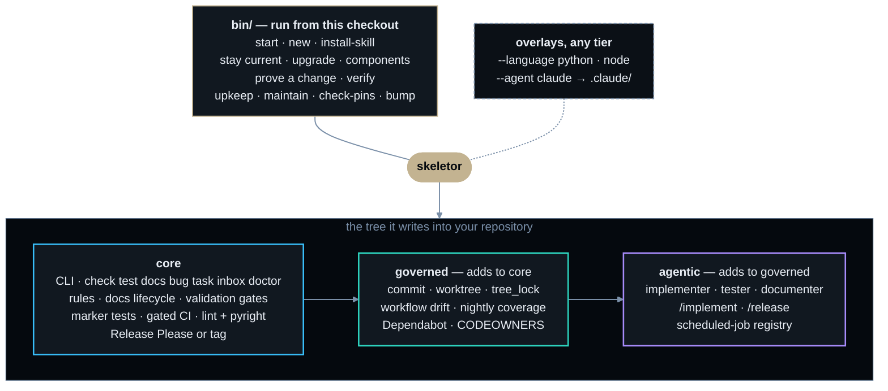

<p align="center">
  
</p>

# skeletor

[](https://github.com/skyrowlabs/skeletor/tags) [](https://github.com/skyrowlabs/skeletor/actions/workflows/verify.yml) [](LICENSE)

A **project shell generator**. Run one command in a blank repo and you get a
tree that governs itself from the first commit: documented conventions an agent
loads every session, a docs lifecycle, marker-based tests, cost-aware CI,
versioning, and optionally a scheduled self-maintenance layer.

It is an **executable that copies real files** — not a guide an agent reads and
then hand-writes files from. And it keeps moving after it has run: a scaffolded
tree records how it was made, so a later template change reaches it as a
three-way merge rather than as a diff you apply by hand.

**[Quick start](#quick-start)** · **[Choosing what you get](#choosing-what-you-get)** · **[What's in the box](#whats-in-the-box)** · **[Staying current](#staying-current)** · **[Changing the template](#changing-the-template)** · **[Design rationale](docs/DESIGN_RATIONALE.md)**

---

## Quick start

Three ways in, in order of how little you have to remember.

| | How | When |
| - | --- | ---- |
| **1** | Say *"Set up this project using skeletor."* | The `/new-project` skill is installed (`bin/skeletor-install-skill`) |
| **2** | Say *"Read `AGENTS.md` in your skeletor checkout and follow it to set up this repo."* | Any agent, nothing installed |
| **3** | Run `bin/skeletor-new` yourself | You want to see every argument |

The skill carries no procedure of its own. It records where skeletor lives and
hands off to [`AGENTS.md`](AGENTS.md), so the two routes cannot drift apart.

To run it yourself from the target repo, with `$SKELETOR` set to wherever you
cloned this one:

```bash
"$SKELETOR"/bin/skeletor-new . --force \
  --name "My Project" --cli mp --tagline "What it is." --tier core
```

Then set up the generated tree. These lines are the scaffold's own Setup block,
the same in its `README.md`, `AGENTS.md` and `docs/DEVELOPMENT.md`:

```bash
python -m venv .venv && .venv/bin/pip install -r scripts/requirements.txt && .venv/bin/python scripts/install_project.py
.venv/bin/pre-commit install --install-hooks && .venv/bin/python scripts/git/install_merge_drivers.py
./mp check pre-push     # every host-runnable CI gate; green on a fresh tree
```

> [!NOTE]
> Line 1 installs the project itself only once `pyproject.toml` declares
> `[project]`. Line 2 installs the git hooks and the clone-local config — the
> `regen-docs` merge driver and `commit.template` — which live in `.git/config`,
> so **every new clone runs it**, not just the first.

[`docs/SETUP_GUIDE.md`](docs/SETUP_GUIDE.md) takes it from there, including
adoption into a repository that already has code.

---

## Choosing what you get

### Tiers

| Tier | Adds |
| ---- | ---- |
| `core` | Agent rules, lazy-loading docs index, plan lifecycle, CLI, marker tests, CI gate, versioning |
| `governed` | Multi-agent tree safety, scoped commits, worktrees, drift checks, ratchets |
| `agentic` | Subagents, `/implement` + `/release` skills, a scheduled-job registry |

See [`docs/TIERS.md`](docs/TIERS.md) for what each costs. **Pick the one you
will maintain, not the one that looks most thorough.**

### The five flags that change what is in the tree

Everything else renders a name into a file. These decide what ships:

| Flag | Question it answers |
| ---- | ------------------- |
| `--tier` | How much governance will you maintain? |
| `--versioning` | **Does anything deploy this?** `release-please` for a published artifact, whose users have no `.git` and so need a tracked `VERSION`; `tag` for a repository run from a checkout, where `git describe` already knows. `tag` is a *subtraction* — the same files, minus four |
| `--agent` | `claude` ships `.claude/` tooling; `none` omits it. The conventions in `docs/rules/` are plain markdown and ship either way, because nothing auto-loads them for any vendor |
| `--language` | Your **product's** language. Not the shell's — `cli/`, `tests/` and `scripts/` are python at every tier, so this only ever adds a second toolchain |
| `--shell-package` | What the shell's python package is **called** (default `cli`). It renames a directory and nothing else |

`--python` is a **floor**, not the interpreter you happen to run: it renders
into pyright's `pythonVersion` and black's `target-version`, which both mean
*at least this*. `--python-ceiling` adds the other end, and CI runs a matrix
over the pair — the two failure modes a matrix catches both live at the ends.

> [!TIP]
> **Rename the shell if your product already owns `cli/`** — the most
> collided-with directory name in a python monorepo. sky.boss moved their
> product out of `cli/` so this template's shell could have it, and paid 119
> failing tests mid-flight. Renaming is cheap here because the package never
> names itself: command groups are found through `__name__` and `__path__`,
> `__main__.py` imports relatively, and the tests go through `tests/shell.py`.
> Decide at scaffold time — `--set-arg` cannot usefully change it later, since
> an upgrade would render the package under the new name as a set of new files.

---

## What's in the box

skeletor has two halves: the tools you run from this checkout, and the tree they
write into your repository. The tiers are cumulative — each adds to the one
before it — and the overlays apply on top of whichever you pick.



### skeletor's own tools

`bin/skeletor` is the entry point — `bin/skeletor --help` lists these, and each
is still runnable directly by the path below. The table is generated from the
files, because the hand-written one it replaced had lost three of the eight:

<!-- GENERATED bin/skeletor — do not hand-edit; run `bin/skeletor --markdown`. -->

| Tool | What it does |
| ---- | ------------ |
| `bin/skeletor-bump` | Bump every location of a pinned tool at once, or refuse to bump it at all. |
| `bin/skeletor-check-pins` | Report how far behind every version this repository pins its users to. |
| `bin/skeletor-components` | What did this tree take from skeletor, and has any of it moved since? |
| `bin/skeletor-install-skill` | Install the /new-project skill into the user's Claude Code config, so a blank repo can be scaffolded by asking rather than by remembering a path. |
| `bin/skeletor-maintain` | The weekly maintenance pass, run locally, waking an agent only if there is work. |
| `bin/skeletor-new` | Scaffold a new project from the skeletor template. |
| `bin/skeletor-upgrade` | Carry a template change into a tree that was scaffolded from an older one. |
| `bin/skeletor-verify` | Generate every tier and run the resulting tree's own gates against it. |

<!-- /GENERATED -->

### In the generated tree

The **Tier** column says which tier ships it: `C` = core, `G` = governed,
`A` = agentic (cumulative). Expand a section for the detail.

#### The project CLI (`./<cli>`)

One discoverable entry point. Command groups are **discovered by module**, so an
overlay can add one without patching an import list.

| Group | Subcommands | Tier |
| ----- | ----------- | :--: |
| `check` | `lint` · `docs` · `doc-links` · `doc-refs` · `reports` · `output` · `merge-drivers` · `pre-push` · `health` | C |
| `test` | `unit` · `integration` · `ui` · `manual` · `all` · `coverage` | C |
| `docs` | `index` · `status` · `file` · `queue-order` · `release-window` · `freeze-release` | C |
| `bug` · `task` | Capture an out-of-scope bug, or small self-contained work, as an issue; each refuses a capture missing a required section | C |
| `inbox` | Read back what the capture lanes hold, so a filed issue is not a queue nobody looks at | C |
| `doctor` | The account facts no file can state: default branch, release PRs, required checks, back-merge, CODEOWNERS | C |
| `commit` | Scoped commit that skips pre-commit's repo-wide stash | G |
| `worktree` | `new` · `drop` · `list` · `holders` | G |
| `report` | `<job>` · `cron` · `watch` | A |

<details>
<summary><strong>Conventions and agent tooling</strong></summary>

The conventions are plain markdown in `docs/rules/`, read because `AGENTS.md`
names them, and they ship whatever `--agent` says:

| Convention | Detail | Tier |
| ---------- | ------ | :--: |
| Rules | `commits` · `docs` · `output` · `testing` · `workflows` (+ `python`/`javascript` by overlay) | C |
| Shared-tree rule | `shared-tree.md` — what stops one agent deleting another's uncommitted work | G |

The tooling lives in `.claude/` and is omitted by `--agent none`:

| Tooling | Detail | Tier |
| ------- | ------ | :--: |
| Permission allowlist | `settings.json` — pre-approved git/gh/lint/CLI calls | C |
| Session bootstrap | `hooks/session-start.sh` installs the host toolchain in remote sessions | C |
| Subagents | `implementer` · `tester` · `documenter` | A |
| Skills | `/implement` (plan → code → tests → docs → filed) · `/release` (phased, stops for a human) | A |

</details>

<details>
<summary><strong>Documentation lifecycle</strong></summary>

| Capability | Detail | Tier |
| ---------- | ------ | :--: |
| Holding tank ↔ archive | `docs/TODO/` and `docs/implementations/`; a plan **moves**, never copies | C |
| Generated indexes | 2 JSON + 2 READMEs, rebuilt in dependency order by `scripts/docs/regen.py` | C |
| Plan classification | `shelf_status` · `blocked_on` gate · `queue_order` · `review_pr` — the last three never inferred | C |
| One imported sort key | `queue_order.py` — the published queue order *is* the real one | C |
| Lazy-loading index | `.github/DOCS_INDEX.md` — a task loads 1–3 docs, not the tree | C |
| Release-anchored reports | `release_window.py` — every report scoped to `<tag>..HEAD` | C |
| Release freeze | `freeze_release.py` — archives editions, re-anchors, refuses a re-freeze | C |
| Merge driver | `regen-docs` — generated files are regenerated on merge, never hand-resolved | C |
| Plan template | `_TEMPLATE.md`, including the `## Dropped, and why` section | C |

</details>

<details>
<summary><strong>Validation gates</strong></summary>

Every one is runnable locally with the same invocation CI uses.

| Gate | Catches | Tier |
| ---- | ------- | :--: |
| `check_doc_tables.py` | A doc registered in neither index table (`AGENTS.md`, `.github/DOCS_INDEX.md`) — one no agent will load | C |
| `check_doc_links.py` | Dead relative links and `#fragments` (ratchet); `--fix` repoints the unambiguous ones | C |
| `check_source_doc_refs.py` | `docs/*` paths cited from source comments that no longer resolve | C |
| `check_commit_subjects.py` | A pushed subject Release Please would silently ignore — or, versioned by tag, one the commit-msg hook would have refused | C |
| `regen.py --check` | A generated index that is stale in the commit that changed its source | C |
| `release_window.py --check` | A report whose anchor is missing, malformed, or wrong for where it lives | C |
| `check_skip_budget.py` | A suite that quietly stopped testing (ratchet) | C |
| `check_coverage_budget.py` | Coverage sliding while nobody looks (ratchet) | C |
| `install_merge_drivers.py --check` | A clone missing the merge driver or `commit.template`, plus regenerations owed | C |
| `check_output_discipline.py` | A status symbol or a stream picked outside `scripts/output.py` — auto-enrolled | C |
| `check_workflow_drift.py` | CI jobs that drift apart: one booting the stack without the pinned python, one running pytest without the project install — auto-enrolled, not a registry | G |
| `tree_lock.py` | Whether a branch change would strand somebody's work | G |

</details>

<details>
<summary><strong>Testing</strong></summary>

| Capability | Detail | Tier |
| ---------- | ------ | :--: |
| Marker registration | A file joins a suite by declaring `pytestmark` — no registry anywhere | C |
| CLI smoke + flag contract | Every command answers `--help` and every read-only one runs; a flag the CLI forwards must be one the script defines | C |
| Docs lifecycle end-to-end | A plan **moves** to the archive and every index follows — run on a disposable copy of the tree | C |
| `require_or_skip` | Skips locally, **fails** in CI, so "green" means "ran" | C |
| Ratchets | Skip count and coverage, each moved deliberately in the same commit | C |
| Shipped tests | `tests/` arrives populated — the shell tests itself, and those tests are the worked example for yours | C |
| Suite hardening | `--strict-markers`, return-not-none as an error, per-test timeout sized for CI | C |
| Registry tests | `reporting_jobs` — registry ↔ CLI ↔ prompts ↔ heartbeats ↔ cron collisions | A |

</details>

<details>
<summary><strong>CI/CD and cost control</strong></summary>

| Capability | Detail | Tier |
| ---------- | ------ | :--: |
| Gate job | Computes `full_suite`/`docs_only` once; every expensive job is gated on it | C |
| Shared gating definition | `docs-only.cjs` — one decision order, read by both workflows, **fail-open** | C |
| Draft discipline | A draft carrying code runs the cheap jobs; `ready_for_review` can only ever add | C |
| Monotonic transitions | Marking a PR ready never *reduces* what runs — asserted, not assumed | C |
| Job-level skipping | Never `paths-ignore` — a required check that never reports blocks forever | C |
| Docs validation workflow | PR-only, by design; the nightly covers direct pushes | C |
| Draft-discipline bot | Comments on a PR opened ready, with the cheaper loop | C |
| Nightly coverage | The expensive suites, off the pre-merge path | G |
| Dependabot | Exempt from gating so bumps actually run the suite before auto-merge | G |
| CODEOWNERS + templates | Bug/feature forms shaped like an actionable capture | G |

</details>

<details>
<summary><strong>Code governance</strong></summary>

| Capability | Detail | Tier |
| ---------- | ------ | :--: |
| Blocking lint set | flake8 `E9,F63,F7,F82,F401` + isort + black; complexity flagged, not blocked | C |
| Whole-project types | pyright `standard` in both the hook and CI — one stale error blocks everyone | C |
| One version pin | `.pre-commit-config.yaml` is the source of truth; parity test enforces mirrors | C |
| Pre-commit hooks | Conventional commit-msg, `.env` block, large-file guard, docs gates | C |
| ESLint ratchet | `--max-warnings=<baseline>`, whole-tree, may only go down | C |
| Prettier | Owns formatting so no lint rule has to argue with it | C |

</details>

<details>
<summary><strong>Versioning and release</strong></summary>

| Capability | Detail | Tier |
| ---------- | ------ | :--: |
| Conventional commits | One subject line, enforced by hook; type decides the bump | C |
| Release Please | Generates `CHANGELOG.md` and `VERSION` — never hand-edited. `--versioning tag` omits it | C |
| `.gitmessage` | The template, with the bump each type causes | C |
| Report freeze | A release closes the window; editions become an immutable record | C |
| `/release` skill | Five phases across turns; **stops** for a human to merge | A |

</details>

<details>
<summary><strong>Scheduled self-maintenance</strong></summary>

| Capability | Detail | Tier |
| ---------- | ------ | :--: |
| One registry | `jobs.py` generates the crontab, the CLI subcommands and the viewer | A |
| Collection/triage split | Deterministic stdlib collection, then a headless agent over the result | A |
| `fix_policy` | `none` by default — blast radius is a decision, not an inheritance | A |
| Outcome ledger | Two rails: no `ok` without an agent run; no `ok` on a red gate | A |
| `declined` as an outcome | An executed-and-declined job still pings its heartbeat | A |
| Heartbeats | One per job, asserted present in `.env.example` by a test | A |
| Worked example | `repo-report` end to end — registry, module, prompt, heartbeat | A |

</details>

---

## Staying current

A scaffold is a starting point that keeps moving. There are **two** adoption
modes, and a tree can be both:

| You have | Manifest | How template changes reach you |
| -------- | -------- | ------------------------------ |
| A scaffolded tree | `.skeletor.json` | `bin/skeletor-upgrade` — renders your base, renders ours, three-way merges |
| Files you copied by hand | `.skeletor-components.json` | `bin/skeletor-components report` — provenance only, no automatic upgrade |

### Upgrading a scaffolded tree

```bash
bin/skeletor-upgrade ../my-project --dry-run        # what would change; never refused, writes nothing
bin/skeletor-upgrade ../my-project --rehearse       # the dry run, then the tree's own gates before and after
bin/skeletor-upgrade ../my-project --ref v0.55.1    # apply, rendering from a released tag
```

| When | Reach for |
| ---- | --------- |
| You want to know which of your gates a release turns red, not just which files conflict | `--rehearse` (add `--quick` to skip the suites). It applies the upgrade in a throwaway worktree beside your tree and runs `check pre-push` there |
| The run refuses because skeletor's checkout is past its newest tag | `--ref <tag>`, so your manifest records a version somebody chose. `--allow-untagged` is the escape |
| A conflict, and you ported the change by hand | `--ported`, which advances the recorded base without touching your bytes |
| A conflict that is only your formatter's doing | `--normalise`, which runs your own formatters over both template sides first |
| A file reads as edited and you want to see what it differs from | `--show <path>` |
| A flag the template gained after you scaffolded | `--set-arg <flag>=<value>` |

> [!IMPORTANT]
> **What an upgrade will not do.** It never writes a conflict marker into your
> tree, never commits, and never deletes. A file you edited is merged only if
> the merge is clean; a conflict leaves your file exactly as it was and puts the
> template's version in `tmp/upgrade/`. **A file skeletor wrote and you deleted
> is not put back** — partial adoption is a set of deletions, and a decision
> that has to be re-made on a schedule is not a decision.

**A tree scaffolds once**, so every argument it records is fixed at that
moment. `--set-arg` changes an argument for *this render only*: your base still
renders from the recorded values, and the difference arrives as an ordinary
template change. Change a rendered value that way rather than by editing the
file. An edited file leaves the record saying the old value, which is what the
base still renders, so that hunk conflicts on every upgrade while the tree
stays green and current.

---

## Changing the template

**The scaffold is the test.** There is no test suite for skeletor itself: a
template change is verified by generating a tree and running *that tree's* own
gates against it.

```bash
bin/skeletor-verify                     # every tier x every language
bin/skeletor-verify --tier core --keep  # one tier, trees left behind to inspect
```

Run it after any edit under `template/`, and run all tiers when the edit touches
`template/core/` — `governed` and `agentic` compose on top of it. `--tier` is
for narrowing a debug loop, not for a final check.

A scaffold whose first check is red teaches that red is normal, so the
definition of done here is that a fresh tree passes its own gates. The grid
generates every configuration rather than one because **tier composition is the
question no single tree can ask**: a reference that resolves in the tree you
tested and dangles in the tree somebody else scaffolds is a defect only the
generator can see.

> [!WARNING]
> **Never run `black` directly on `template/`.** It sees `{{PLACEHOLDER}}`
> rather than the value it renders to, so its line-length decisions are made
> against the wrong widths. Scaffold a tree, format there, port the change back.

### Repository layout

| Path | What it is |
| ---- | ---------- |
| `bin/` | The tools in the [table above](#skeletors-own-tools), plus `render_guard.py`, which they share |
| `AGENTS.md` | One-page instruction sheet for an agent doing a setup |
| `.claude/skills/new-project/` | The skill's source; `bin/skeletor-install-skill` installs it |
| `template/core/` · `governed/` · `agentic/` | The three tiers, composed in that order |
| `template/python/` · `node/` | Language overlays — your **product's** language. The python toolchain that lints the shell ships at `core` |
| `template/agent-claude/` | `.claude/` tooling, applied per tier and omitted by `--agent none` |
| `upstream.json` | What was harvested from the repository skeletor was extracted from, and what was declined; `upstream.local.json` (gitignored) says where to look |
| `docs/SETUP_GUIDE.md` | The full procedure, including adoption into an existing repo |
| `docs/TIERS.md` | What each tier buys, and what it costs |
| `docs/DESIGN_RATIONALE.md` | The incident behind each mechanism |
| `docs/MAINTENANCE.md` | The weekly pass, and what an agent running it must not do |

---

## The idea

> A rule that two files can express is a rule that will drift, and the copy that
> is wrong is always the one being read.

Where a set of things must be checked, the set is **discovered** by pattern — any
test file with a marker, any CI job that boots the stack — rather than maintained
as a list. Exemptions live in an allowlist **with a written reason**, which is
what turns a divergence from a failure into a decision.

The second idea is smaller and matters as much: **write the reason next to the
rule.** A rule whose reason is written down can be evaluated when it becomes
inconvenient. A rule without one gets deleted by whoever trips over it first.

---

## License

MIT — see [`LICENSE`](LICENSE). Copyright (c) 2026 SKYROW LABS LLC.

**What you scaffold is yours.** The files `bin/skeletor-new` writes into your
repository carry no notice requirement and no attribution to skeletor. License
the result however you like — [`NOTICE`](NOTICE) says so explicitly, because a
scaffolding tool whose output dragged its own copyright into every project would
be one nobody could use for the thing it is for.
